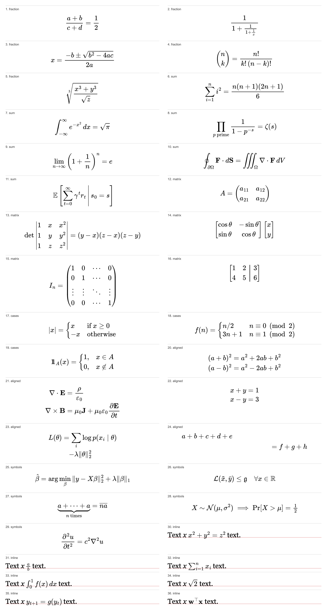

# Equations

Kindle's MathML support is inconsistent, so equations ship as PNG images with the LaTeX as `alt` text. `offprint.equations` makes those images for every adapter that has LaTeX. The PDF adapter keeps cropping its equations, and they pass through untouched.



## The stage

`typeset_math(doc, preamble="")` is a stage of its own, between the adapter and `validate`:

```
adapter → typeset_math → validate → generate_cover → render_epub
```

An adapter can't do this job, because an adapter only produces the IR and rendering would need one copy per adapter. The EPUB renderer can't either, because it only consumes the IR, and other outputs will want the same images. As a stage, it turns `Equation(latex)` into `Equation(latex, asset)`, and the renderer only has to place an image it was given.

`collect_requests` and `apply_rendered` are pure. Only `typeset_math` touches Chromium and the disk, and it takes the renderer as a parameter, so `tests/test_equations_stage.py` runs without a browser. A paper with no LaTeX starts nothing and comes back equal to what went in.

What the stage does to the IR:

| Input | Output |
|---|---|
| `Equation` with `latex` and no `asset` | `asset` set, `latex` reduced to the bare formula. A `\tag{...}` moves to `number` if the adapter gave none. |
| `Equation` with an `asset` | Untouched. This is every PDF equation. |
| `MathInline` with `latex`, simple | Replaced with text runs: `x_i` becomes italic *x* with a subscript. |
| `MathInline` with `latex`, anything else | `asset` set. |
| `MathInline` without `latex` | Untouched. |

Bare formula means `clean_latex` has removed `$$`, `\[`, `\(` and the whole-document wrapper that PubMed Central often puts in `<tex-math>`.

The result's `problems` go out through `EpubResult.problems`, so `convert` prints them on stderr.

## The renderer: MathJax in the Chromium we already have

The issue asked for a TeX toolchain against a Python or JS renderer. All of these ran here, on the 36 formulas in `tests/math_corpus.py` and on 40 harder constructs taken from what papers really use (`\bm`, `\mathds`, `\substack`, `eqnarray`, `\xrightarrow`, `dcases`, ...).

| Candidate | Corpus | Harder set | Speed | Added install |
|---|---|---|---|---|
| TeX: `latex` + `dvipng` | 36 of 36 | 37 of 40 (1) | 9 ms each, one `latex` run per batch | TeX Live: 9.1 GB here, a few hundred MB as minimal apt packages |
| TeX: `latex` + `dvisvgm` + `rsvg-convert` | 36 of 36 | same | 87 ms each | The above, plus librsvg |
| **MathJax 3.2.2 in Chromium (chosen)** | **36 of 36** | **39 of 40 (2)** | **8 ms each**, 0.33 s startup | **One 2.3 MB vendored file** |
| MathJax 3.2.2 in Node + `rsvg-convert` | 36 of 36 | not run | 28 ms each | Node and librsvg |
| MathJax 4.1 in Chromium | 36 of 36 | 33 of 40 (3) | not comparable | About 12 MB across some 80 files, loaded through a fake origin |
| KaTeX 0.19 in Chromium | 35 of 36: no `multline` | 29 of 40 | 68 ms each | 4 MB of JS, CSS and fonts |
| matplotlib mathtext | 21 of 36: no matrices, `cases` or `aligned` | not run | | matplotlib and its dependencies |

(1) The three misses were my harness putting `smallmatrix`, `dcases` and `array` outside math mode. Treat TeX as 40 of 40 given the right packages.
(2) With the macros in `assets/page.html`. Only `\intertext` fails, and it's reported.
(3) Stock configuration, without those macros. MathJax 4 does have `\mathbbm` natively.

Measured on an Apple Silicon Mac. Speeds are per formula across the corpus. The chosen row is the finished renderer, with its PNG reduction included; its images average 6.3 KB and the largest is 13.3 KB.

**Quality.** The side-by-side at 300 ppi shows MathJax's layout and TeX's agreeing closely, because MathJax implements TeX's layout rules with Computer Modern-style fonts. On the 32 formulas that could be compared directly, height above the baseline and depth below it differ from `dvipng`'s by a median of 0.05 em, and 0.36 em at worst. KaTeX is also good, but it numbers `align` lines itself. TeX is the reference, yet it isn't flawless: `\mathbb{1}` from `amssymb` drew a wrong glyph, as papers that use it need `bbm` or `dsfont`.

**Why not TeX, the reference?** Cost and safety.

- CI would need TeX Live, and so would every user. The MathJax route needs nothing that the cover doesn't already need.
- A paper's macros would run in a real TeX engine. `-no-shell-escape` stops commands, but TeX can still read files. MathJax's TeX parser is a sandboxed page in an offline browser, with no file system to reach.

**Why not MathJax 4?** It's the likely next step: better Unicode coverage, blackboard digits, and automatic line breaks for long equations. But its fonts and extensions load dynamically, so it can't be one file, `file://` hung here, and it took a routed fake origin to run. MathJax 3 has everything in `tex-svg-full.js`.

**PNG, not SVG.** PNG works everywhere, and an SVG with a PNG fallback can't be tested without a Kindle.

### Licences

| What | Where | Licence |
|---|---|---|
| MathJax 3.2.2 (`es5/tex-svg-full.js`, unmodified, from npm), fonts included | `src/offprint/equations/assets/` | Apache-2.0, in `MATHJAX-LICENSE.txt` |

Apache-2.0 code can be combined into a GPLv3 work. Nothing else was added, and `pyproject.toml` doesn't change. To upgrade, replace the file, which changes the engine fingerprint and so invalidates the cache.

## Images

- `MathSettings.px_per_em` is 60. That's 14.4 pt at 300 ppi, so a reader's larger type setting doesn't have to upscale the image.
- PNG in gray and alpha: black ink on transparency. Note that dark mode on a device might draw black ink on black. That wasn't testable here.
- Sized in em, so a formula follows the reader's type size. Each image has `width` in em, and `max-width: 100%` shrinks one too wide for the screen.
- The baseline falls on a whole pixel row. Inline images get `vertical-align: -<depth>em`, where the depth comes from MathJax's box and is stored in `Asset.box`.

Rendering happens on a canvas from MathJax's SVG, not by taking a screenshot of the page, which is what makes it 8 ms and not 70. Two details matter there. The SVG needs MathJax's stylesheet inside it, or array rules vanish. Ink overhangs MathJax's box sideways, so the canvas is wide and Python crops the sides back to the ink.

Inline math becomes text when `simple_math` recognises all of it: letters, digits, Greek, common relations and one level of `_` or `^`. Text reflows and is searchable. `x_i^2` stays an image, because text would set the scripts side by side.

Very long inline formulas shrink to the screen's width and then sit slightly off the baseline. Long display equations shrink too, and they don't break into lines.

## The baseline

The issue's criterion is that inline images sit on the text baseline in the preview, and the preview (#7) isn't built yet. `tests/test_equations_browser.py` measures it in Chromium with the book's real markup and `kindle.css`:

- For each inline formula in the corpus, at 24, 40 and 60 px type, the image's bottom edge is `depth × size` below the baseline, within 0.6 px.
- In pixels, an `n` in an image ends on the same row as an `n` of text, within 1 px.

None of this has run on a Kindle. Whether Kindle honours `vertical-align` and em widths on images needs a device or Kindle Previewer.

## The preamble

`typeset_math(doc, preamble=...)` takes the paper's `\newcommand`s, for the LaTeX adapter (#11) to pass. The preamble is part of the cache key. Every formula sees those definitions and no others.

That isolation needs work. MathJax keeps a formula's `\newcommand` for the rest of the session, so a formula could depend on an earlier one, and on whether the earlier one came from the cache. `render.js` restores the definitions after every formula, and a test covers each way of defining something.

If the preamble doesn't parse, the formulas render without it, `math.preamble_failed` is reported and nothing is cached, so the report can't be lost to a cache hit.

## The cache

Entries live in `<cache dir>/math/<key>.json`. The key is the SHA-256 of the formula, the display style, the preamble, the settings and the engine fingerprint, which hashes the vendored files and the Playwright version (which pins Chromium's build).

- A hit returns the bytes a fresh render would. A test renders the same book both ways and compares the EPUBs byte for byte.
- Only successful renders are stored, in one atomic write. A damaged entry counts as a miss.

## Problems

| Code | Meaning | What the reader sees |
|---|---|---|
| `math.render_failed` | MathJax rejected this formula, or it came out blank. The message has TeX's reason. | The LaTeX as text |
| `math.renderer_unavailable` | Chromium is missing, so nothing uncached could be drawn. | The LaTeX as text |
| `math.preamble_failed` | The paper's macros didn't parse. | Images, without the macros |
| `math.system_font` | MathJax has no glyph for a character, so the machine's font drew it. Such an image depends on the machine. | An image |
| `math.cache_unwritable` | The cache can't be written. Harmless, but slower next time. | An image |
| `epub.equation_text_fallback` | The renderer got an `Equation` with no image. | The LaTeX as text |
| `epub.inline_math_text_fallback` | The renderer got LaTeX inline math with no image. | The text, or the LaTeX as text |

A formula that fails shows up twice in the report, once from each stage: why it failed, and what the reader gets.

## Tests

`tests/test_equations_text.py` and `tests/test_equations_stage.py` need nothing but Python. `tests/test_equations_render.py` and `tests/test_equations_browser.py` need Chromium, and skip locally without it but fail in CI, like the cover's tests. The test that runs the corpus through `epubcheck` skips when `epubcheck` isn't on `PATH`, as it isn't in CI.

To remake the contact sheet:

```sh
PYTHONPATH=tests uv run python tests/math_contact_sheet.py docs/equations-contact-sheet.png
```
